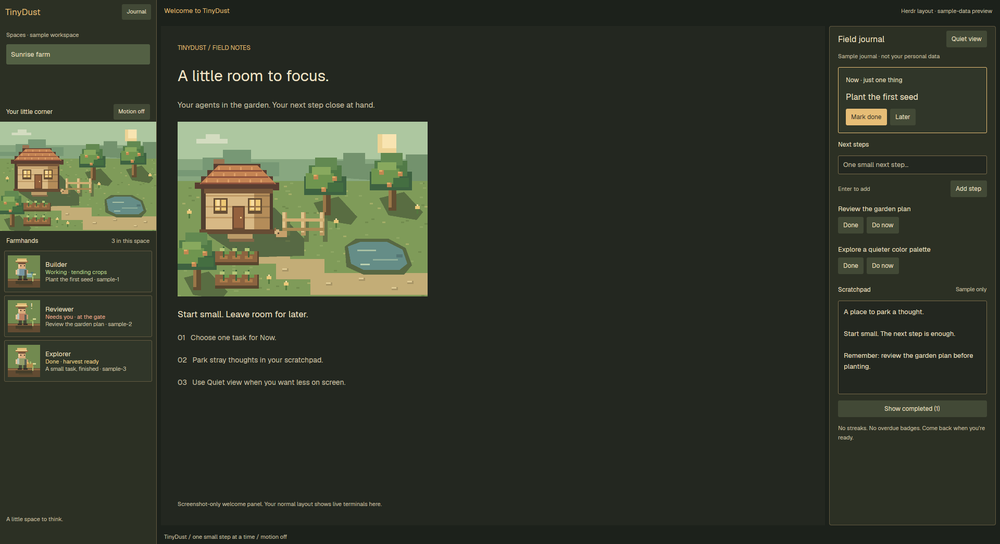

# TinyDust

**A little room to focus.** A cozy, 8-bit-inspired [Herdr](https://herdr.dev) layout: agents in the garden, one next step, and somewhere to park a thought.



*Captured in Herdr, with explicitly labeled sample agents, tasks, and workspace. The center welcome panel is screenshot-only; the installed layout shows your real terminals there. No personal notes, conversations, or project names are included.*

## A small, useful place

- **Original pixel farm.** A tiled roof, vegetable beds, orchard, pond, and a sleeping cat. Stepped highlights, contact shadows, and diagonal cast shadows add depth without blurring the pixels. No ripped game assets.
- **Live farmhands.** One farmer per status-reporting agent in the current space. Click to focus its agent. Working, needs-you, done, and idle are written out—not just color-coded.
- **Field journal.** A multiline scratchpad saved locally as you type. The journal stays with this layout across spaces; it isn't a separate note per project.
- **Now, next, later.** Choose exactly one task for **Now**. Add small steps with Enter, mark them done, reopen completed tasks, or undo the last completion. Completed tasks stay hidden until you ask for them.
- **Quiet view.** Hides the landscape and next-step/completed lists, while keeping your current task, notes, and agent statuses accessible. “Show more” brings everything back.
- **Motion off by default.** Optional native farmer animation; Quiet view suppresses it too. No animation timers, confetti, or flashing alerts added by TinyDust.
- **Your normal workspace.** Herdr's tabs, pane controls, files, changes, spaces, and status bar remain available. The **Journal** button hides or shows the right sidebar.

### ADHD-conscious, not a medical claim

TinyDust aims to reduce what competes for attention: one visible priority, a place for stray thoughts, stable agent order, reversible completion, explicit labels, and optional motion. No streaks, deadlines, guilt counters, or automatic task promotion. Different people need different things; this is a design preference, not a treatment or clinically validated accessibility claim.

## Install

Requires **Herdr**. Tested with **Herdr 0.1.16 on Linux**; other versions and platforms are not yet verified. Open Herdr once so it creates its customization guide and API files.

Ask your coding agent:

> Read ~/.config/herdr-app/AGENTS.md, then install the TinyDust layout from https://github.com/jerichosiahaya/tinydust. Read the source first, leave my existing layouts intact, and run herdr-app check on both mods.

Or, with Git and Python 3:

```sh
git clone https://github.com/jerichosiahaya/tinydust.git
cd tinydust
python3 scripts/install.py
herdr-app do layout.switch --name tinydust
```

Review the installer before running it. It copies only TinyDust's layout, theme, preview art, and two mods into your Herdr config, then checks the mods. It refuses to overwrite existing TinyDust files unless you pass `--update`. It does not change your keyboard shortcuts, other layouts, or terminal sessions.

You can also select **tinydust** in **Settings → Look**. If new mods aren't discovered immediately, restart Herdr once.

### Update

```sh
git pull --ff-only
python3 scripts/install.py --update
```

The installer backs up replaced code under `~/.config/herdr-app/backups/tinydust-<timestamp>/`. Your journal lives in Herdr's runtime storage, not these source files. Updates don't intentionally modify it. Back up that storage separately before changing or deleting mods.

### Controls

| Action | How |
| --- | --- |
| Focus an agent | Click its farmer |
| Add a task | Type a small step, then Enter or Add step |
| Pick the current task | Do now |
| Put it back in the list | Later |
| Complete / restore | Mark done, Undo last completion, or Reopen |
| Reduce visual load | Quiet view; Show more to return |
| Toggle notes sidebar | Journal, in the top-left brand bar |
| Animate working farmers | Motion on; off initially |
| Navigate journal controls | Native buttons and inputs support keyboard focus; Enter submits a task |

On a narrow window, hide the journal or collapse Herdr's sidebar. Small garden panels omit the landscape. The task list and scratchpad remain scrollable. This is a desktop layout, not a mobile UI.

## Privacy and storage

**Herdr mods are trusted, unsandboxed code. Read them before installing.**

TinyDust's two runtime mods:

- Make **no network requests**, spawn **no programs**, install **no agent plugins**, and do not read terminal output or project files.
- Read Herdr's agent/space state to draw the garden and issue normal focus/layout commands when clicked.
- Save the journal with Herdr's per-mod-copy `localStorage`, under the `journal-v1` key. Preferences use shared keys prefixed with `tinydust.`.
- Keep data **on this device, in plaintext**. There is no cloud sync, encryption, or automatic journal backup. Other trusted software on your device can access it. Don't use it as a secret store.

Back up your Herdr config's `data/` directory **privately** while Herdr is closed before removing/reinstalling a mod or migrating machines. Don't commit it to Git. A cloned layout or a second journal mod instance may have its own storage; TinyDust is not a multi-window collaborative notebook.

If stored data is malformed, TinyDust shows an error and refuses to replace it. If saving fails, the journal reports it—keep the panel open and copy the notes somewhere safe. This first version has a 500-task limit, a 240-character task-title limit, and no delete/edit/export UI; completed tasks can be reopened.

Herdr's own network, telemetry, notifications, shipped mods, and remote-machine behavior are separate from TinyDust. Quiet view does not silence Herdr's built-in sounds or notifications; configure those in **Settings → Alerts**.

## Develop

No npm dependencies or build step are needed to run the layout. Node.js 22+ is used only for tests; Python 3 generates the original SVG and installs files.

```sh
npm test
python3 scripts/draw-art.py
python3 scripts/install.py --update
herdr-app check ~/.config/herdr-app/mods/tinydust
herdr-app check ~/.config/herdr-app/mods/tinydust-journal
```

| Path | Purpose |
| --- | --- |
| `layouts/tinydust.json` | Window arrangement and mod slots |
| `themes/tinydust.json` | Earthy terminal and panel colors |
| `mods/tinydust/` | Brand bar, farm art, live agents |
| `mods/tinydust-journal/` | Notes, tasks, Quiet view, storage |
| `scripts/draw-art.py` | Deterministic, dependency-free SVG art source |
| `scripts/screenshot.py` | Temporary sample-data preview; restores the previous layout |
| `tests/` | State/render tests and screenshot-only welcome panel |
| `RECIPE.md` | Brief for rebuilding or remixing the layout |

To regenerate the README screenshot, install TinyDust, open Herdr at a comfortable desktop size (the current capture is 1920×1046), close overlays, then run:

```sh
python3 scripts/screenshot.py
```

The script temporarily switches layouts, substitutes sample data and a welcome panel for private content, captures `preview.png`, then restores the previous layout. **Always inspect the whole image before publishing it.**

### Validation

Five automated test cases cover storage validation, missing keys, Now-task behavior, completion/reopening/undo, preservation of newly added tasks, notes round-tripping, save failures, demo isolation, agent filtering/focusing, compact rendering, and motion/Quiet view. Render tests use host doubles, not a full GUI driver. Both mods pass Herdr's native check; normal and sample-data layouts were visually inspected on Linux. Full keyboard/screen-reader and cross-platform testing remains outstanding.

## Credits and license

Inspired by the cozy farming-sim genre and the idea of agents as little characters in [Pixel HQ](https://github.com/bnhan2710/pixel-hq). TinyDust's artwork and mods are original. No Stardew Valley or Harvest Moon assets, names, music, or characters are bundled; this is not affiliated with either game.

TinyDust is [MIT licensed](LICENSE). Herdr and the shipped mods that the layout references are separate projects under their own licenses; they aren't bundled here.
