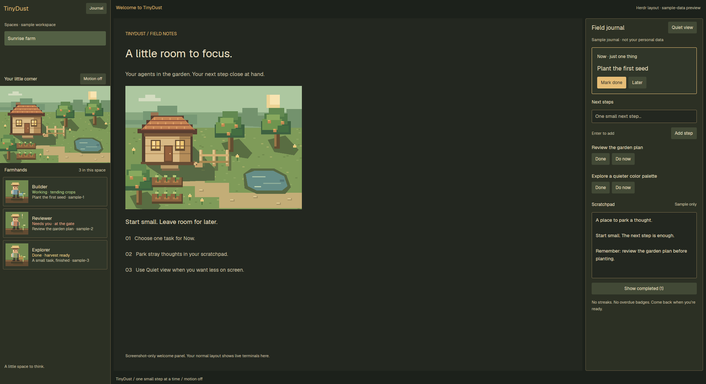

# TinyDust

An interactive, 8-bit-inspired Herdr farm with a rose roof, sage grass, and animal/human agent characters. Working agents water crops, idle ones sit on picnic blankets, blocked ones ask for help, and finished ones cheer. A simple journal keeps Now and Notes visible while Tasks stays folded away.

## What you see

- A 300px left sidebar, resizable 44–480. A 46px TinyDust brand row with + New menu and Journal toggle, Herdr's Spaces initially 150px tall, then Your little corner. Herdr's settings/machine footer stays below.
- The corner has Motion and Visit farm controls and an exact `N working · N trees` counter. A tree-free farmhouse illustration forms the backdrop; active agents grow the visible grove. Beneath it, three lanes per row contain actual clickable characters and short nameplates, crop plots, help signs, delivery patches, and picnic blankets.
- Up to six characters per page, or three in shorter sidebar panels. Previous/Next reaches everyone. A focused agent gets a pale ground marker; a newly focused off-page agent brings its page into view. A compact, scrollable agent list remains below. Small or Quiet sidebars omit the scene but keep this list.
- Visit farm opens a 940×720 native dialog with the same live farm, larger sprites, Back to work, and Alert settings. The world is at most 960px wide and scrolls vertically if needed. Escape closes it. No terminal sessions or workspaces are created or closed.
- Eight characters: Miso/cat, Clover/rabbit, Maple/fox, Cocoa/bear, Fern/frog, Sunny/duck, Rowan/farmer, Sage/gardener. Muted lilac, rose, sage, honey, and teal. They are artwork for existing agents, not additional running agents.
- Center: Herdr's normal tab bar, active terminal splits, pane controls, Files/Changes panels and status bar. Right: 320px Journal, resizable 280–460, with Now, 240px multiline Notes, and collapsed Tasks.
- Terminal `#28262b`, text `#f2e7e2`, chrome `#302c33`, accent `#e8b4c4`. Respect the user's fonts. Keep text readable; no flashing warnings or reward counters.

## How it behaves

- **+ New:** one popup with New tab (`tab.new` in the captured space), New space (`space.new` on the captured machine), and New terminal (`pane.split` right of the captured pane). Capture targets before opening; recheck their existence before acting and never silently target another workspace/pane. Disable tab/split choices when their prerequisites are absent. Close the popup before executing. The button becomes + on a collapsed rail; Journal hides below 220px and the full brand name below 240px. Screenshot demo actions must not create anything.

- Read only agents in the active space. Preserve model order; include other spaces after the visible list in keyboard agent navigation. Hash the terminal address with unsigned 31-based hashing modulo eight for a stable character. Reordering must not swap species; repeats are allowed.
- **Working:** two original watering frames, tilled soil, growing shoots, falling water droplets with motion on. **Idle:** seated/rest pose on a picnic blanket, `z z z`. **Blocked:** help sign and static `Help!` bubble. **Done:** raised arms, gentle cheering motion, `Finished!` bubble. Unknown remains explicit in the list.
- Click a scene character, its nameplate, or its list row: `agent.focus` with its exact terminal address. From Visit farm, close that dialog and focus the agent. Sample characters only change local preview selection.
- One tree for each currently working agent in this space. It is an instantaneous activity display, not a lifetime achievement; the grove shrinks when agents finish/rest/leave. Draw at most 24 trees and disclose the exact total/visible count above that limit. Clicking a tree identifies its worker and gives a one-second shake with motion on. No points, currencies, or clicks that send work to an agent.
- Work and cheer animation are native `.loop()` operations; position changes use native transitions. No frame polling or state polling. One cancellable one-shot timer clears a tree shake after a click. Motion is off initially and respects the existing `tinydust.motion` preference. Quiet suppresses it. Resume game explicitly leaves Quiet view and enables motion.
- Herdr emits completion alerts itself: configured sound, and an in-app toast unless the user is looking at that agent. The layout names TinyDust as its toast renderer, preserving the original title/body/action while showing the character. Do not post a second notification or play a second sound. In Herdr 0.1.16 completion uses level `info`, title `<name> finished`, action `agent.focus` with `args.terminal`; it is not `success`.
- **Bundled completion chime:** `mods/tinydust/harvest-complete.mp3`, an original soft 1.2-second C-major arpeggio. Herdr 0.1.16 has no per-layout sound default. The installer selects this path in global `settings.json` → `sounds.done` only when no custom sound is set; preserve mute, blocked sound and unrelated fields. `--keep-sound` opts out; `--use-tinydust-sound` explicitly replaces a custom sound. Explain that the choice affects all Herdr layouts. Back up settings privately and atomically replace them only after validation and a stale-snapshot check; refuse symlinked settings. Never add a duplicate playback observer.
- Herdr turns `done` into `idle` when the agent is seen. Clear the cheer then. Do not assume every `working → idle`, disappearance, restart or reload means success. No external desktop-notification helper or push service is installed.
- Journal: preserve `journal-v1` exactly. Expand Tasks to add with Enter/Add; empty or >240-character titles show an inline error, and at most 500 tasks are retained. Focus chooses one Now task. Circle/checkmark completes/reopens it; undo must preserve subsequently added tasks and notes. Completing Now does not auto-promote another task.
- Notes save on change, device-locally in plaintext. Missing storage means a fresh journal; malformed storage must not be overwritten. Surface save failures and retain draft input. Quiet hides the task backlog, not Notes or Now. Journal focus commands focus Notes.

## Built from

- `layouts/tinydust.json`: root row → sidebar + work column; work body → active tab, hidden Files/Changes, journal. Root `toast: "tinydust"`.
- `themes/tinydust.json`: ANSI and semantic panel colors.
- `mods/tinydust/main.js`: brand/default garden/`role: "world"` dispatch, measured dimensions, page selection, tree interaction, overlay controls. Notification props (`overlay` plus `title`) dispatch to `toastView`.
- `creation.js`: native three-choice creation popup, current context capture, stale-target checks and explicit native commands. `game.js`: pure status labels, stable character identity, pagination, working-grove count, bounded lane positions. `scene.js`: native drawing, original work/rest/cheer sprites, water, nameplates, tree clicks, optional motion. `toast.js`: notification presentation, dismissal, and original actions.
- `mods/tinydust-journal`: native input, textarea and buttons; validation and immutable task operations in `state.js`. Per-copy localStorage schema `{version:1, notes, tasks:[{id,text,done}], now}`.
- Shared settings: `tinydust.motion`, `tinydust.quiet`. The installer may update global `sounds.done` under the documented policy; runtime mods do not rewrite settings. No journal schema changes or new keyboard bindings.
- Shipped mods referenced, not bundled: spaces, tabs, pane, files, changes, workspace-chrome, workspace-status. Use Herdr live data, normal focus/layout/overlay commands and theme colors. Runtime mods perform no network calls, background helper subprocesses, agent-plugin installs, terminal-output reads, or project-file reads. Explicit New menu choices do create shells through Herdr commands.
- `draw-art.py`: original postcard, tree-free live terrain, and tree sprite. `draw-characters.py`: eight original characters, two work frames, rest and cheer poses, plus README lineup. Both use only Python's standard library.
- `make-chime.py`: synthesize sine-based notes with gentle attack/release, normalize to a conservative peak, and encode to MP3 with ffmpeg. Only developers regenerating the committed MP3 need ffmpeg. `completion_sound.py`: sound-selection policy, preference preservation, private settings backup and replacement. `install.py` copies the MP3 along with code/art, then configures sound after native checks.

## Watch out

- Herdr missing localStorage keys may be `undefined`, not only `null`. `nextCommand()` resolves a string.
- Keep scene unit hit boxes narrow: full-scene overlapping wrappers can swallow another unit's clicks. Keep decorative layers noninteractive and provide native named Buttons for actions.
- Bound scenes through pagination, not by silently dropping agents. Tree cap must be visible in the text, and all relevant agents must contribute to the counter, including off-page ones.
- A snapshot's demo props must never focus a real agent, write the personal journal, or change real motion/Quiet preferences. Sample world state is separate.
- The screenshot substitutes the expanded farm for terminal content and marks sample data explicitly. The regular center remains terminals; Visit farm is a dialog.
- Never publish config data, shared state, real terminal screenshots, or personal notes. No game asset packs or World of Codecraft sources are included; its work/rest/marker/expanded-map patterns are design inspiration only.
- GPUI is native, not HTML/CSS. Read installed generated types. `herdr-app check` alone does not cover all later states; check populated scene and toast fixtures too.
- No task edit/delete/export UI, cloud sync, tool-specific animations, custom agent hooks, pathfinding, XP, combat, or OS push notifications in this version. Quiet does not silence Herdr's own sounds. Full keyboard/screen-reader and cross-platform behavior remain unverified.

## Done when

1. Both mods pass `herdr-app check`, and `python3 scripts/check-native.py` passes populated animated/static scenes and completion/generic toast variants.
2. Ten Node tests pass: creation routing/stale targets/demo isolation, journal persistence/undo/error handling plus tree counts/caps, pagination, focus targets, character stability, pose assets, tree feedback, Quiet/motion, demo isolation and native completion-payload handling.
3. Inspect normal and sample-data layouts. Verify characters stay inside their lanes, trees stand on ground, names/bubbles remain readable and every agent is reachable.
4. Confirm existing terminals and the journal remain intact. Nothing sends input to an agent or starts another agent. Only explicit New menu selections create shells/spaces; test fixtures must not create real sessions.
5. Confirm the public screenshot contains only labeled sample data. Document that completion delivery and playback are owned by Herdr, not duplicated by a mod observer.
6. Eight Python sound/installer tests pass, covering first/repeated install, custom and mute preservation, opt-out/force behavior, backups, invalid/symlinked/stale settings, write failures and a sandboxed installer. Decode the MP3 and verify duration/peak/no clipping after regenerating it. The installed asset must exist and match the selected global path.
